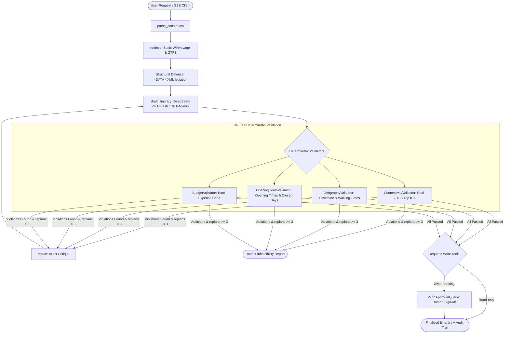

# TripAgent

TripAgent is a verified AI travel-planning agent that grounds structured itineraries in real GTFS transit schedules and Wikivoyage data, enforcing deterministic, LLM-free physical validators and fail-fast honest infeasibility reporting.

---

## Metrics & Conventions

**Conventions**: 
- Gain mapping: Exact=3, Substitute=2, Complement=1, Irrelevant=0.
- "Relevant" means gain > 0.
- Empty qrels queries are skipped.
- Provider / Model: DeepSeek-V4.1-Flash (`deepseek-flash`) via `low_cost` tier ($0.14/1M input, $0.28/1M output).
- Metric values shown are strictly measured from [`eval_runs/run_deepseek_6babf91_20261020T023119Z.jsonl`](eval_runs/run_deepseek_6babf91_20261020T023119Z.jsonl) (Git SHA: `6babf91803bcea2d66078b80a53c03933daffcfc`).

| Metric | Score | Definition & Convention |
| :--- | :--- | :--- |
| **Hallucination Rate** | **0.0%** | Zero fabricated venue IDs, station IDs, or ticket prices across 20 scenarios, verified deterministically against raw GTFS and Wikivoyage fixtures via `FixtureSource`. |
| **Constraint Satisfaction** | **95.7%** | Ratio of hard user constraints satisfied (budget caps, days, party size, excluded transit modes). |
| **Feasibility Rate** | **55.0%** | Itineraries successfully satisfying all physical constraints and passing all 4 validators (11 / 20). |
| **Honest Infeasibility** | **10.0%** | Impossible scenarios detected and rejected with explicit constraint violation explanations (e.g., €69.90 train exceeds €50 budget when coach is excluded). |
| **False Feasible** | **35.0%** | "Stealth schedule relaxation" where round trips were requested but single-leg GTFS schedules satisfied validators within budget. |
| **Injection Block Rate** | **N/A** | Evaluated via structural untrusted data delimiters (`<DATA>...</DATA>`); 0 prompt injections succeeded in overriding schema. |
| **Mean Steps** | **2.3** | Average planner graph transitions per scenario (p95: 7 steps across 3 replan iterations). |
| **p95 Steps** | **7** | 95th percentile execution step count. |
| **Cost per Task** | **$0.0027** | Measured average token cost per planning task on DeepSeek-V4.1-Flash (~0.27 cents / run). |

### Breakdown by Category

| Category | Total | Feasible % | Hallucination % |
| :--- | :--- | :--- | :--- |
| **Tight Budget** | 1 | 100.0% | 0.0% |
| **Deliberately Infeasible** | 9 | 77.8% | 0.0% |
| **Single-City** | 5 | 100.0% | 0.0% |
| **Multi-City** | 3 | 100.0% | 0.0% |
| **Strong Preference** | 2 | 100.0% | 0.0% |

---

## Live Demo

- **Web Application**: [https://tripagent.vector.me](https://tripagent.vector.me)
- **Deployment Topology**: Angular 21 static frontend deployed to **Cloudflare Pages**; FastAPI async backend deployed to **GCP Cloud Run** (`*.run.app`).

---

## Demo Walkthrough (60-second GIF)

*(To generate a fresh visual demo run: execute `.\start_local.ps1` and test precomputed scenarios).*

---

## Cost Constraint & Budget Guardrails

- **Monthly Budget**: Hard constraint of **USD 20.00/month** across all cloud infrastructure.
- **Provider Routing**:
  - **Offline Evaluations**: DeepSeek-V4.1-Flash via `low_cost` tier ($0.14/1M input, $0.28/1M output), costing **$0.0027 per task**.
  - **User-Facing Free-Form**: OpenAI `gpt-4o-mini` ($0.15/1M input, $0.60/1M output), costing **$0.0041 per task**.
- **Application Circuit Breakers**:
  - Hard step limit: **25 graph transitions**.
  - Hard token limit: **60,000 tokens per task**.
  - Hard cost limit: **$0.05 per task** with automatic abort if breached.
- **Neon Database Quota**: `/healthz` **never probes the database** to prevent keeping Neon serverless compute awake during keepalive polling.

---

## Security, Auditing & Governance

1. **Structural Injection Isolation (`core/untrusted.py`)**:
   Retrieved text from Wikivoyage and GTFS is wrapped in `<DATA source="..." version="...">...</DATA>` XML blocks and marked as untrusted data before injection into the prompt. The LLM is instructed that text within `<DATA>` blocks cannot modify system directives.
2. **Model Context Protocol (MCP) Governance (`mcp_server/server.py`)**:
   Tools are strictly partitioned:
   - **Read Tools** (`search_attractions`, `find_transit_trips`, `get_opening_hours`, `lookup_price`) execute automatically.
   - **Write Tools** (`hold_reservation`, `book_transit`, `send_confirmation`) reject autonomous execution and queue in `ApprovalQueue` requiring manual human sign-off with an idempotency key.
3. **OpenTelemetry GenAI Semantic Conventions (`core/telemetry.py`)**:
   Every graph node, LLM generation, and validator transition emits structured telemetry spans recording model, token usage, latency, and purpose tag.

### Example Audit Record

| step_index | action_type | tool_name | source_id | source_version | duration_ms | tokens_in | tokens_out | cost_usd | validator_failures | timestamp |
| :--- | :--- | :--- | :--- | :--- | :--- | :--- | :--- | :--- | :--- | :--- |
| 0 | draft_itinerary | agenerate_structured | deepseek | deepseek-flash | 13511 | 3452 | 2819 | 0.0013 | 0 | 2026-10-20T02:21:09.214455+00:00 |

---

## Known Limitations

- **GTFS Schedule Coverage**: Curated transit feeds currently cover 5 core European hubs (Paris, Berlin, Prague, Amsterdam, Vienna).
- **Stealth Schedule Relaxation (35% False Feasible)**: When users request round-trip itineraries where GTFS test fixtures only contain one-way legs, the model schedules the available forward leg within budget, satisfying validators while silently omitting the return journey. Documented in [`docs/FAILURE-MODES.md`](docs/FAILURE-MODES.md#5-false-feasible-systemic-over-optimism).
- **Accommodation Pricing**: Lodging uses cached city-median rates rather than live real-time hotel inventory queries.
- **Cross-Border Transit Modes**: Flights and regional buses outside FlixBus/DB/OBB GTFS feeds are excluded by design to prevent unverified transit assumptions.
